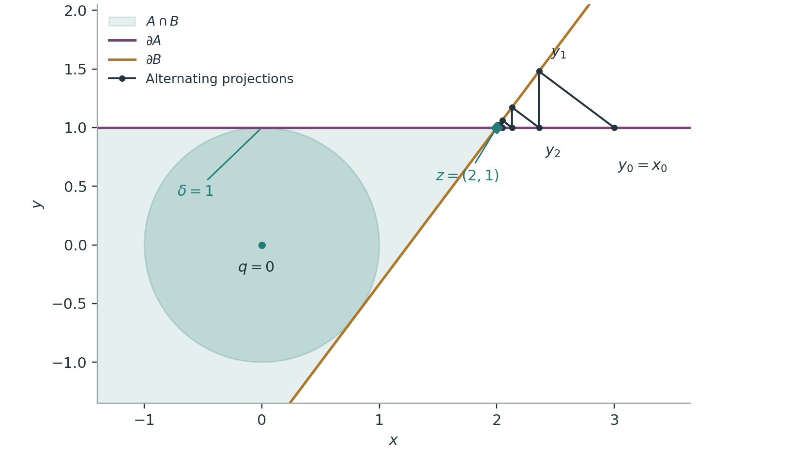
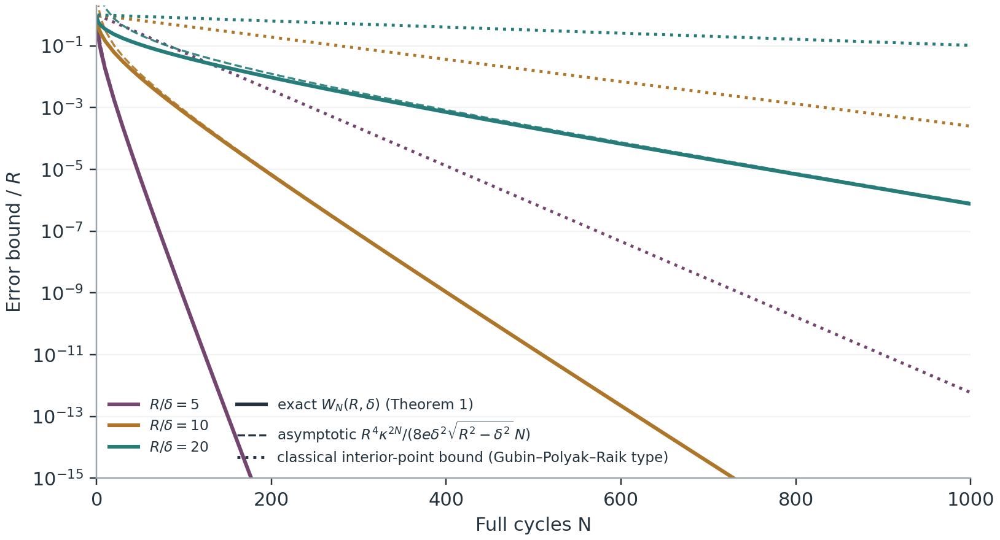
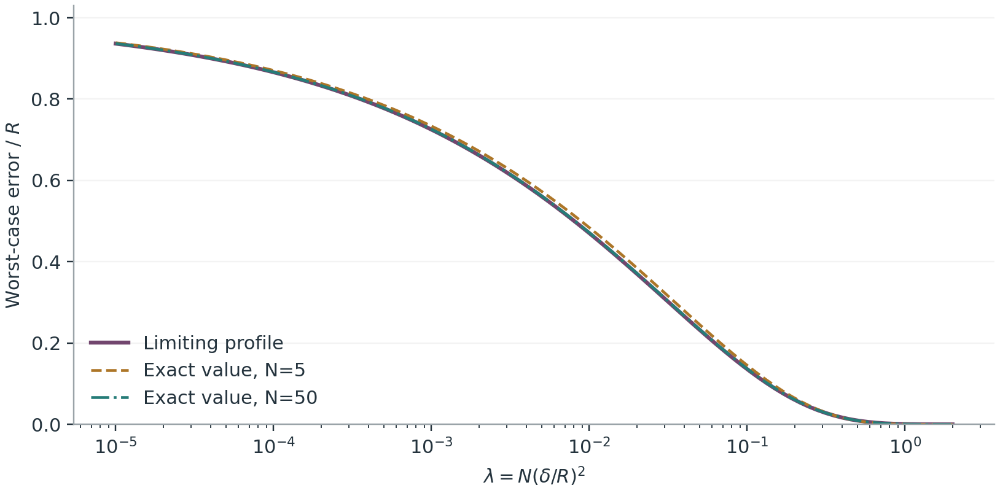

# Exact worst-case convergence of alternating projections with a common interior ball

**Anonymous** · Evidence Press candidate research paper · 3 November 2026

Version 0.1.0-candidate · DOI: [10.5281/zenodo.23922446](https://doi.org/10.5281/zenodo.23922446)

## Abstract

Alternating projections find a point in the intersection of two convex sets by projecting onto each set in turn. Suppose the two sets contain a common ball of radius $\delta>0$ and the starting point lies within distance $R$ of its centre. We determine the exact worst-case distance to the intersection after every number $N\ge1$ of cycles, in every dimension. If $R\le\sqrt2\,\delta$, one cycle always reaches the intersection. Otherwise, with $\kappa=1-2\delta^2/R^2$, the worst-case error is

$$
\max_{0\le c\le\kappa}c^{2N-1}
\left(\sqrt{R^2-\delta^2}
-\delta\sqrt{\frac{1+c}{1-c}}\right).
$$

Two planar halfspaces attain this value. The formula and the attaining halfspaces are due to Luner and Grimmer, who conjectured that nothing worse can happen (arXiv:2410.14811, versions 1 and 2, Proposition 6.1 and Conjecture 6.2). We prove that conjecture. The proof follows each trajectory through two numbers, its distance from the ball centre and its next step length. It compares them with the halfspace trajectory through a monotone value function and converts the final state into a distance with a sharp error bound. The same argument gives the exact worst case when the two sets contain balls of different radii about a common centre, after any number (at least two) of single projections, and in any real Hilbert space. It also gives the exact worst residual, which recovers the exact rate of Zamani and Glineur in the limit $\delta\to0$. Consequences include the sharp equivalent $R^4\kappa^{2N}/(8e\delta^2\sqrt{R^2-\delta^2}\,N)$, a limiting profile when $N\delta^2/R^2$ is held fixed, and practical cycle counts. In our examples the exact count is 1.6 to 2.9 times smaller than an elementary bound with the same geometric factor, and five to nine times smaller than the classical interior-point guarantee. After the first projection, near-worst instances lie only $\Theta(1/N)$ from the intersection.

## 1. Introduction

### 1.1 The question

Many computational problems ask for a point satisfying two convex constraints at once: an image consistent with measured data and with a positivity constraint, a matrix with prescribed entries that is also positive semidefinite, a signal with given spectrum and given support. *Alternating projections* (von Neumann's method; POCS in signal processing) solves such problems by repeatedly replacing the current point by the nearest point of one set, then of the other. It is simple and widely used, and its qualitative convergence theory is classical. For a precise statement of what this paper adds, fix the following setting.

Fix $\delta>0$ and $R\ge0$. Let $A,B\subseteq\mathbb R^d$ be closed convex sets, with

$$
\overline B(q,\delta)\subseteq A\cap B,
\qquad \|x_0-q\|\le R.
\tag{1}
$$

Write $P_D$ for Euclidean projection onto a nonempty closed convex set $D$. Define

$$
x_N=(P_BP_A)^N x_0,
\qquad
W_N(R,\delta)=
\sup_{d,A,B,q,x_0}\operatorname{dist}(x_N,A\cap B),
\tag{2}
$$

where the supremum is over all finite dimensions and all instances satisfying (1). A cycle consists of two projections. The supremum is taken anew for each horizon $N$. So $W_N$ is the best guarantee that holds for *every* pair of sets with a common ball of radius $\delta$ and every start within $R$ of its centre. It is a *minimax* quantity: the worst instance may change with $N$.

### 1.2 What was known

Under an interior-ball (Slater-type) condition, alternating projections converge linearly. This goes back to Gubin, Polyak and Raik (1967); see also Bauschke and Borwein (1993, 1996) and Deutsch (2001). A non-sharp form of the radius-loss inequality (6) below, with a similar telescoping, appears in De Bernardi and Miglierina (2021, Fact 4.1 and Theorem 4.2). The standard argument (recalled in Proposition 9 below) gives a per-projection contraction factor of about $1-\delta^2/(2R^2)$. Without interiority, convergence can be arbitrarily slow (Bauschke, Deutsch and Hundal, 2009) and in infinite dimensions need not even hold in norm (Hundal, 2004). For two subspaces, Kayalar and Weinert (1988) proved the exact identity $\|(P_BP_A)^N-P_{A\cap B}\|=c_F^{2N-1}$, where $c_F$ is the cosine of the Friedrichs angle. This is the origin of the exponent $2N-1$ below. Error bounds and regularity notions quantify the linear rate more generally (Bauschke, Borwein and Li, 1999; Drusvyatskiy, Li and Wolkowicz, 2016; Banjac and Goulart, 2018). Exact rates have also been obtained in non-transversal situations (Ochiai, Sekiguchi and Waki, 2023).

None of these results gives the exact worst case over the whole class (1). That kind of question is what *performance estimation* (PEP) addresses: computing, often numerically through semidefinite programs, the exact worst case of an algorithm over a class of problems (Drori and Teboulle, 2013; Taylor, Hendrickx and Glineur, 2016, 2017). Zamani and Glineur (2024, Theorems 4.4 and 4.5) used it to find the exact worst-case *residual* of alternating projections without any interiority assumption. Luner and Grimmer (2024) extended performance estimation from functions to structured sets. In versions 1 and 2 of their preprint, their Section 6 treats alternating projections under (1). Proposition 6.1 constructs two halfspaces whose error is the right side of (3) below. Conjecture 6.2, supported by numerical performance estimation, asserts that this is the exact worst case. Version 3 (2 June 2026) and the journal version (Luner and Grimmer, 2026) omit the alternating-projections section; the associated repository retains it under "Additional Topics" (Luner, n.d.). We do not infer resolution or withdrawal from the omission.

Two normalisation remarks prevent apparent mismatches with the source. The conjecture maximises over $c\in[0,1]$; we maximise over $[0,\kappa]$. These agree because the bracket in (3) vanishes at $c=\kappa$ and is negative on $(\kappa,1)$. The source's numerical table reports *squared* distances (its PEP objective), whereas $W_N$ is the distance itself. The conjecture is stated for $\beta$-smooth sets. Halfspaces belong to that class for every $\beta$, so the value is the same whether the sup in (2) runs over smooth sets or over all closed convex sets.

### 1.3 Main results

**Theorem 1 (exact finite-horizon minimax error).** For every integer $N\ge1$:

- If $R\le\sqrt2\,\delta$, then $W_N(R,\delta)=0$.
- If $R>\sqrt2\,\delta$, put $\kappa=1-2\delta^2/R^2$. Then

$$
\boxed{\displaystyle
W_N(R,\delta)=
\max_{0\le c\le\kappa}c^{2N-1}
\left(\sqrt{R^2-\delta^2}
-\delta\sqrt{\frac{1+c}{1-c}}\right).}
\tag{3}
$$

The maximum in (3) has a unique maximiser in $(0,\kappa)$ and is attained by two halfspaces in $\mathbb R^2$. Restricting (2) to any fixed dimension $d\ge2$ leaves its value unchanged. In dimension one, one cycle always reaches the intersection.

The contribution of Theorem 1 is the universal upper bound; the formula and the attaining construction are Luner and Grimmer's. Section 8 extends the same argument (Theorem 7). There the two sets may contain balls of *different* radii $a$ and $b$ about a common centre, the output may be taken after any number $k\ge2$ of single projections, and the space may be any real Hilbert space. Section 8 also gives the exact worst-case residual (Theorem 8). Section 7 derives sharp asymptotics, and Section 9 translates the results into practical terms.

**How to read this paper.** Section 2 sets up notation and the scalar functions used throughout. Sections 3–5 prove the upper bound in three steps: a one-step comparison (Lemma 2), an error bound (Lemma 3) and a monotone value function (Lemma 4). Section 6 verifies attainment. Sections 7–9 contain the consequences, extensions and interpretation. Appendix A treats fixed instances.

### 1.4 Proof idea

Describe a projection trajectory by two quantities: its distance $r$ from the common-ball centre and its next residual (step length) $t$. The ball forces a loss of squared radius of at least $t^2+2\delta t$ per step. Two consecutive projection normals also bound the next residual in terms of $(r,t)$. Together these inequalities say that the next state is coordinatewise bounded by the state produced by a pair of halfspaces tangent to the ball.

A direct iteration of that observation is not enough: the halfspace angle associated with $(r,t)$ can change when the actual trajectory takes a smaller step. We therefore maximise over all smaller residuals at the current radius. The resulting scalar value function, a dynamic-programming device, is monotone in both state variables. It does not increase under one exact halfspace update when the remaining horizon is reduced by one. A sharp error bound converts the final residual state into distance from the intersection. These statements telescope to (3).

## 2. Projection identities and a scalar state description

Translate $q$ to zero. Set $y_0=P_Ax_0$, and thereafter index individual projections by

$$
y_j=\begin{cases}
P_By_{j-1},&j\text{ odd},\\
P_Ay_{j-1},&j\text{ even},
\end{cases}
\qquad
n_j=y_{j-1}-y_j,\quad t_j=\|n_j\|,\quad r_j=\|y_j\|,
\tag{4}
$$

for $j\ge1$ (and $r_0=\|y_0\|$). Thus $y_j\in B$ for odd $j$ and $y_j\in A$ for even $j$. The output after $N$ cycles is $y_m$, where $m=2N-1$. The next residual $t_{m+1}=\operatorname{dist}(y_m,A)$ is used only in the proof; it is not an additional projection in the definition of the output.

Use the normal-cone convention

$$
N_D(z)=\{u:\langle u,w-z\rangle\le0\text{ for all }w\in D\}.
$$

Because the common ball is interior to $A\cap B$, the normal-cone sum rule holds:

$$
N_{A\cap B}(z)=N_A(z)+N_B(z),\qquad z\in A\cap B.
\tag{5}
$$

This is the identity used in Luner and Grimmer (2024, equation (6.3)). If $p=P_Dx$, where $D$ contains $\overline B(0,\delta)$, and $n=x-p\ne0$, then applying the normal inequality to the ball point $\delta n/\|n\|$ gives

$$
\langle n,p\rangle\ge\delta\|n\|,
\qquad
\|x\|^2\ge\|p\|^2+2\delta\|n\|+\|n\|^2.
\tag{6}
$$

Both inequalities hold trivially when $n=0$. Consequently $r_j\le r_{j-1}$ for all $j\ge1$, and $r_0\le\|x_0\|\le R$. Since $y_{j-1}$ and $y_{j+1}$ belong to the same set and $y_{j+1}$ is the projection of $y_j$ onto it,

$$
\langle n_j,n_{j+1}\rangle\le-t_{j+1}^2,
\tag{7}
$$

so $t_{j+1}\le t_j$ by Cauchy–Schwarz. A zero residual places the iterate in both sets and makes all later residuals zero.

We next define the scalar functions used in the proof. Throughout, $\delta$ is fixed. For $r\ge\sqrt2\,\delta$, put

$$
p(r)=\sqrt{r^2-\delta^2},\qquad
T(r)=p(r)-\delta,\qquad
\kappa(r)=1-\frac{2\delta^2}{r^2}.
$$

For $0\le c\le\kappa(r)$, define

$$
s(c)=\sqrt{1-c^2},\qquad
w(c)=\frac{\delta(1+c)}{s(c)},\qquad
D(r,c)=p(r)-w(c),
$$

$$
\tau(r,c)=s(c)D(r,c)
=p(r)s(c)-\delta(1+c).
\tag{8}
$$

Geometrically, in the halfspace picture of Section 6, $c$ is the cosine of the angle between the two boundary lines, $w(c)$ is the distance along a boundary line from the foot of the perpendicular from the centre to the corner, and $D(r,c)$ is the distance from a point at radius $r$ on that line to the corner. One checks that $w(\kappa(r))=p(r)$, so $D(r,\kappa(r))=0$. The map $c\mapsto\tau(r,c)$ decreases strictly from $T(r)$ to zero on $[0,\kappa(r)]$. For $0\le t\le T(r)$ its inverse is

$$
c(r,t)=
\frac{-\delta(\delta+t)
+\sqrt{(r^2-\delta^2)(r^2-(\delta+t)^2)}}{r^2}
=\cos\!\Big(\arcsin\frac\delta r+\arcsin\frac{\delta+t}r\Big).
\tag{9}
$$

Write

$$
E(r,t)=D(r,c(r,t))=
\frac{t}{\sqrt{1-c(r,t)^2}}.
\tag{10}
$$

We call a pair $(r,t)$ with $r\ge\sqrt2\,\delta$ and $0\le t\le T(r)$ an *admissible state*. The formulas include $t=0$, where $c(r,0)=\kappa(r)$ and $E(r,0)=0$, and $t=T(r)$, where $c(r,t)=0$ and $E(r,t)=t$. At $r=\sqrt2\,\delta$ the only admissible residual is $t=0$.

For fixed $t$, $c(r,t)$ increases with $r$, as the angle form of (9) shows; consequently $E(r,t)=t/s(c(r,t))$ also increases with $r$. For fixed $r$, $E(r,t)$ increases with $t$, because $D(r,c)$ decreases with $c$ and $c(r,t)$ decreases with $t$. Also $T(r)$ increases with $r$.

The corresponding halfspace update is

$$
r_* =\sqrt{r^2-t^2-2\delta t},\qquad
 t_*=c(r,t)\,t.
\tag{11}
$$

If $c_0=c(r,t)$ and $s_0=\sqrt{1-c_0^2}$, substitution of $t=p(r)s_0-\delta(1+c_0)$ gives

$$
p(r_*)=c_0p(r)+\delta s_0,\qquad
c(r_*,t_*)=c_0,\qquad
D(r_*,c_0)=c_0D(r,c_0).
\tag{12}
$$

In particular the updated state is admissible ($c_0\le\kappa(r_*)$) and retains the same angle. These identities also hold at the endpoints by direct substitution.

## 3. Exact domination of the next residual

**Lemma 2 (one-step state comparison).** Let $j\ge0$. Suppose $t=t_{j+1}>0$ and $t_{j+2}>0$, and put $r=r_j$. Then $r>\sqrt2\,\delta$, $0<t<T(r)$, and

$$
r_{j+1}\le\sqrt{r^2-t^2-2\delta t},
\qquad
t_{j+2}\le c(r,t)\,t.
\tag{13}
$$

**Proof.** The first inequality is (6). For the second, put $\gamma=t_{j+2}/t$, let $a,b$ be the unit directions of $n_{j+1},n_{j+2}$, and set $c=-\langle a,b\rangle$. The points $y_j$ and $y_{j+2}$ lie in the same set, so (7) gives $\gamma\le c$. Apply (6) at the two projected points $y_{j+1}$ and $y_{j+2}$, and use $y_j=y_{j+1}+ta=y_{j+2}+\gamma t\,b+ta$. This gives

$$
\langle a,y_j\rangle\ge\delta+t,
\qquad
\langle b,y_j\rangle\ge\delta-(c-\gamma)t.
\tag{14}
$$

Here $0<\gamma\le c\le1$. If $c=1$, then $b=-a$, and adding the two inequalities would give $0\ge2\delta+\gamma t$, a contradiction. Hence $0<\gamma\le c<1$.

The vectors $e_1=a$ and $e_2=(b+ca)/\sqrt{1-c^2}$ are orthonormal. Since $c>0$, their coordinates satisfy

$$
\langle e_1,y_j\rangle\ge\delta+t>0,
\qquad
\langle e_2,y_j\rangle\ge
\frac{\delta(1+c)+\gamma t}{\sqrt{1-c^2}}>0.
$$

Pythagoras therefore gives

$$
r^2\ge(\delta+t)^2+
\frac{[\delta(1+c)+\gamma t]^2}{1-c^2}.
\tag{15}
$$

The right side increases with $c\in[0,1)$ for fixed $\gamma,t$: the derivative of $[\delta(1+c)+\gamma t]/\sqrt{1-c^2}$ has the sign of $\delta(1+c)+c\gamma t>0$. Replacing $c$ by $\gamma\le c$ and rearranging yields

$$
r^2\gamma^2+2\delta(\delta+t)\gamma
+(\delta+t)^2+\delta^2-r^2\le0.
\tag{16}
$$

Since $\gamma>0$, this implies $r^2>\delta^2+(\delta+t)^2$, so $r>\sqrt2\,\delta$ and $t<T(r)$. The positive root of the quadratic is (9), giving $\gamma\le c(r,t)$. $\square$

The same admissibility condition holds at a final output even if the following projection reaches the intersection. Indeed, if $j\ge1$ and $y_j\notin A\cap B$, then $t_{j+1}>0$, and $t_j>0$ because $y_{j-1}$ lies in the other set. Their unit normals $a=n_j/t_j$ and $b=n_{j+1}/t_{j+1}$ obey

$$
\langle a,y_j\rangle\ge\delta,
\qquad
\langle b,y_j\rangle\ge\delta+t_{j+1},
\qquad
\langle a,b\rangle=-c<0,
$$

by (6) and (7); as before $c<1$. Using the orthonormal directions $a$ and $(b+ca)/\sqrt{1-c^2}$ gives

$$
r_j^2\ge\delta^2+\frac{[\delta+t_{j+1}+c\delta]^2}{1-c^2}>\delta^2+(\delta+t_{j+1})^2.
\tag{17}
$$

Thus $(r_j,t_{j+1})$ is admissible. This observation will be used at $j=m$.

## 4. A sharp error bound

**Lemma 3 (distance from the intersection).** Suppose $y\in A$, $\|y\|\le r$, $r\ge\sqrt2\,\delta$, and $t=\operatorname{dist}(y,B)$ satisfies $0\le t\le T(r)$. Then

$$
\operatorname{dist}(y,A\cap B)\le E(r,t).
\tag{18}
$$

The same assertion holds with the sets exchanged.

Lemma 3 is a sharp error bound in the sense of bounded linear regularity (Bauschke, Borwein and Li, 1999): it bounds the distance to the intersection by a function of the distance to the other set. It is attained by halfspaces, and it holds for any point satisfying its hypotheses, not only for points of a trajectory.

**Proof.** If $t=0$, the point is feasible. Otherwise let $z=P_{A\cap B}y$, $d=\|y-z\|$ and $e=(y-z)/d$. Since $A\cap B\subseteq B$, $d\ge t$. If $d=t$, use $E(r,t)\ge t$.

Assume $d>t$. The sum rule (5) gives

$$
de=Ua+Vb,
$$

with $U,V\ge0$, $a\in N_A(z)$ and $b\in N_B(z)$ unit vectors whenever the corresponding coefficient is positive. If $V=0$, then $de\in N_A(z)$, and $y\in A$ gives $d^2=\langle de,y-z\rangle\le0$, which is impossible. If $U=0$, then $de\in N_B(z)$, so $z=P_By$ and $d=t$. Hence $U,V>0$. Since $y\in A$, $\langle a,e\rangle\le0$. Also

$$
0<\mu:=\langle b,e\rangle\le t/d<1.
\tag{19}
$$

Positivity follows by taking the inner product of $de=Ua+Vb$ with $e$. The upper bound follows because $B$ lies in the halfspace $\{w:\langle b,w-z\rangle\le0\}$, whose distance from $y$ is $d\mu$. In particular $b\ne\pm e$, so $b$ and $e$ span a plane, which contains $a$.

Choose a unit vector $\ell$ perpendicular to $e$ in this plane, oriented so that

$$
a=-\sigma e+\alpha\ell,
\qquad b=\mu e-\nu\ell,
\qquad
\nu=\sqrt{1-\mu^2}>0,
$$

with $\sigma=-\langle a,e\rangle\ge0$. The $\ell$-component of $de=Ua+Vb$ gives $U\alpha=V\nu>0$, so $\alpha=\sqrt{1-\sigma^2}>0$. The $e$-component gives $V\mu-U\sigma=d>0$. Hence

$$
K:=\mu\alpha-\nu\sigma=\frac{\alpha d}{V}>0,
\qquad 0\le\sigma<\mu.
$$

Write $z_e=\langle z,e\rangle$ and $z_\ell=\langle z,\ell\rangle$. The common ball gives $\langle a,z\rangle\ge\delta$ and $\langle b,z\rangle\ge\delta$, that is,

$$
\alpha z_\ell-\sigma z_e\ge\delta,
\qquad
\mu z_e-\nu z_\ell\ge\delta.
$$

Multiply the first inequality by $\mu$ and the second by $\sigma$ and add. Because $K\le\mu$,

$$
z_\ell\ge\frac{\delta(\mu+\sigma)}K\ge\delta,
\qquad
z_e\ge\frac{\delta+\nu z_\ell}{\mu}
\ge\frac{\delta(1+\nu)}\mu>0.
$$

Since $y=z+de$, and any component perpendicular to this plane only increases the norm, $r^2\ge\|y\|^2\ge(z_e+d)^2+z_\ell^2\ge(z_e+d)^2+\delta^2$. Therefore

$$
p(r)
\ge d+\frac{\delta(1+\nu)}\mu
\ge d+\frac{\delta\bigl(d+\sqrt{d^2-t^2}\bigr)}t.
\tag{20}
$$

The last step uses (19) and the fact that $(1+\sqrt{1-\mu^2})/\mu$ decreases on $(0,1]$. The last expression in (20) is strictly increasing for $d\ge t$, starts at $t+\delta\le p(r)$, and diverges. Its unique value equal to $p(r)$ is $E(r,t)$: substitution of $d=t/\sqrt{1-c(r,t)^2}$ reduces the equality to $\tau(r,c(r,t))=t$. Thus $d\le E(r,t)$. $\square$

## 5. A monotone value function and proof of the upper bound

For integers $k\ge0$, define on the admissible states

$$
V_k(r,t)=\max_{0\le u\le t}E(r,u)\,c(r,u)^k
=\max_{c(r,t)\le c\le\kappa(r)}D(r,c)\,c^k.
\tag{21}
$$

The two expressions agree because $u\mapsto c(r,u)$ is a decreasing bijection of $[0,t]$ onto $[c(r,t),\kappa(r)]$. For $k=0$ use $c^0=1$, including at $c=0$. Since $E(r,t)$ increases with $t$,

$$
V_0(r,t)=E(r,t).
\tag{22}
$$

**Lemma 4 (monotonicity and halfspace comparison).** The function $V_k$ is nondecreasing in each of $r,t$ on the admissible states. For the update $(r_*,t_*)$ in (11),

$$
V_{k-1}(r_*,t_*)\le V_k(r,t),\qquad k\ge1.
\tag{23}
$$

**Proof.** Monotonicity in $t$ follows by enlarging the maximisation interval in the first expression in (21). For fixed $u$, both $E(r,u)$ and $c(r,u)$ increase with $r$, proving monotonicity in $r$. Two admissible states with $r_1\le r_2$ and $t_1\le t_2$ can be compared through $(r_2,t_1)$, which is admissible because $T$ increases.

Put $c_0=c(r,t)$. If $c_0=0$, the update has $r_*=\sqrt2\,\delta$, $t_*=0$, and (23) is immediate. (This case does not arise in the proof of Theorem 1, where Lemma 2 gives $t<T(r)$.) Otherwise take any $c'\in[c_0,\kappa(r_*)]$. On $[0,\kappa(r)]$ the function $c\,p(r)+\delta\sqrt{1-c^2}$ increases, since

$$
p(r)-\frac{\delta c}{\sqrt{1-c^2}}>0;
$$

indeed $p(r)\ge w(c)=\delta(1+c)/\sqrt{1-c^2}$ there. Since $r_*\le r$, $\kappa(r_*)\le\kappa(r)$. Equation (12) gives

$$
p(r_*)=c_0p(r)+\delta\sqrt{1-c_0^2}
\le c'p(r)+\delta\sqrt{1-c'^2}.
$$

Using $\delta\sqrt{1-c'^2}=(1-c')w(c')$, we obtain

$$
D(r_*,c')\le c'D(r,c').
\tag{24}
$$

Multiply by $c'^{\,k-1}$, maximise, and enlarge the interval from $[c_0,\kappa(r_*)]$ to $[c_0,\kappa(r)]$. This proves (23). $\square$

**Proof of the upper bound in Theorem 1.** Consider an instance with positive final error at $y_m$. Then $t_1,\ldots,t_{m+1}$ are positive. Lemma 2 (with $j=0$) makes $(r_0,t_1)$ admissible, and (17) does the same for all subsequent states $(r_j,t_{j+1})$, $1\le j\le m$. For each $0\le j<m$, Lemma 2 shows that the actual next state $(r_{j+1},t_{j+2})$ is coordinatewise at most the halfspace update $(r_*,t_*)$ of $(r_j,t_{j+1})$; both states are admissible. Lemma 4 therefore gives

$$
V_{m-j-1}(r_{j+1},t_{j+2})\le V_{m-j-1}(r_*,t_*)
\le V_{m-j}(r_j,t_{j+1}).
$$

Lemma 3, applied to $y_m$ with $t=t_{m+1}=\operatorname{dist}(y_m,A)$, and telescoping yield

$$
\begin{aligned}
\operatorname{dist}(y_m,A\cap B)
&\le V_0(r_m,t_{m+1})\\
&\le V_m(r_0,t_1)\\
&\le\max_{0\le c\le\kappa(r_0)}D(r_0,c)c^m\\
&\le\max_{0\le c\le\kappa(R)}D(R,c)c^m.
\end{aligned}
\tag{25}
$$

The last inequality uses $r_0\le R$, inclusion of the angle interval, and the fact that $D(r,c)$ increases with $r$. Zero final error requires no argument. If $R\le\sqrt2\,\delta$, positive final error would force $r_0>\sqrt2\,\delta$ by Lemma 2, a contradiction. This proves the upper bound and the termination statement. $\square$

## 6. Attainment and evaluation of the maximum

We verify the attaining family in the present normalisation. It is a translation and reorientation of the construction in Luner and Grimmer (2024, Proposition 6.1).

Fix $0<c<\kappa$, set $s=\sqrt{1-c^2}$, and take

$$
A=\{(u,v):v\le\delta\},
\qquad B=\{(u,v):su-cv\le\delta\}.
\tag{26}
$$

Both sets contain $\overline B(0,\delta)$. Their boundary lines meet at the corner

$$
\zeta=(w(c),\delta).
$$

Choose $x_0=(\sqrt{R^2-\delta^2},\delta)\in A$. Its norm is $R$, so the first projection onto $A$ leaves it unchanged. Direct projection gives

$$
y_j-\zeta=
\begin{cases}
D(R,c)c^j(c,s),&j\text{ odd},\\
D(R,c)c^j(1,0),&j\text{ even}.
\end{cases}
\tag{27}
$$

Both directions belong to the normal cone of $A\cap B$ at $\zeta$: they are nonnegative combinations of $(0,1)$ and $(s,-c)$. Thus $\zeta=P_{A\cap B}y_j$ and the error after $N$ cycles is $D(R,c)c^{2N-1}$. The objective is continuous, positive in $(0,\kappa)$ and zero at $c=\kappa$, so its maximum is attained inside this interval. This proves equality in (3). The examples embed in any $d\ge2$ by taking Cartesian products with $\mathbb R^{d-2}$. In one dimension, closed convex sets are intervals, and projecting a point from one interval onto an intersecting interval leaves it in their intersection.

*Figure 1. The halfspace construction of Luner and Grimmer attains the exact worst-case value at every horizon. Each projection moves the iterate towards the corner and shrinks its distance to the corner by the factor $c$. The starting point can remain fixed while the angle varies with the horizon.*

For a convenient scalar evaluation, put $m=2N-1$ and

$$
S=\frac{\sqrt{R^2-\delta^2}}\delta>1,
\qquad \xi=\sqrt{\frac{1+c}{1-c}}.
$$

The objective is

$$
\delta(S-\xi)\left(\frac{\xi^2-1}{\xi^2+1}\right)^m,
\qquad 1\le \xi\le S.
$$

Its critical-point equation is

$$
\xi^4+4m\xi^2-4mS\xi-1=0.
\tag{28}
$$

The polynomial has one sign change in its coefficient sequence, so it has exactly one positive root. Its value is negative at $1$ and positive at $S$; hence this root lies in $(1,S)$ and specifies the unique maximiser. The quartic is an evaluation of the existing halfspace formula, not a separate novelty claim.

## 7. Sharp asymptotics and the small-interiority profile

The exact theorem makes the asymptotic analysis one-dimensional. Define

$$
C=\frac{R^4}{4\delta^2\sqrt{R^2-\delta^2}},
\qquad
H(c)=\frac{\delta}{(1-c)\sqrt{1-c^2}},
\qquad
J_m=\frac{m^m}{(m+1)^{m+1}}.
$$

Since $D(R,\kappa)=0$ and $-\partial_cD(R,c)=H(c)$,

$$
D(R,c)=\int_c^\kappa H(u)\,du,
\qquad H(\kappa)=C.
$$

The function $H$ increases on $[0,1)$. With $c_m=\kappa m/(m+1)$, Theorem 1 therefore gives

$$
H(c_m)\kappa^{m+1}J_m
\le W_N(R,\delta)
\le C\kappa^{m+1}J_m.
\tag{29}
$$

For the lower inequality, evaluate the objective at $c_m$. For the upper inequality, use $D(R,c)\le C(\kappa-c)$ and maximise $c^m(\kappa-c)$.

**Corollary 5 (relative asymptotics).** For fixed $R>\sqrt2\,\delta$,

$$
\boxed{\displaystyle
W_N(R,\delta)\sim
\frac{R^4}{8e\delta^2\sqrt{R^2-\delta^2}}
\frac{\kappa^{2N}}{N}.}
\tag{30}
$$

The same equivalent holds with varying $R_N>\sqrt2\,\delta_N$ whenever $N\delta_N^2/R_N^2\to\infty$.

**Proof.** One has $J_m\sim1/(e(m+1))$ and

$$
\frac C{H(c_m)}
=\left(\frac{1-c_m}{1-\kappa}\right)^{3/2}
\left(\frac{1+c_m}{1+\kappa}\right)^{1/2}
\le\left(1+\frac{\kappa}{(m+1)(1-\kappa)}\right)^{3/2}.
\tag{31}
$$

Thus the ratio of the bounds in (29) tends to one if $m(1-\kappa)\to\infty$, which is the stated condition. Since $m+1=2N$, (30) follows. At fixed $\kappa$, the relative error in (30) is $O_\kappa(N^{-1})$. $\square$

Define

$$
\mathcal L(0)=1,
\qquad
\mathcal L(\lambda)=\max_{0<v<1}(1-v)e^{-4\lambda/v^2}
\quad(\lambda>0).
\tag{32}
$$

**Corollary 6 (critical limit and uniform additive profile).** If $\varepsilon=\delta/R\to0$ and $N\varepsilon^2\to\lambda\in[0,\infty)$, then

$$
\frac{W_N(R,\delta)}R\longrightarrow\mathcal L(\lambda).
\tag{33}
$$

Moreover,

$$
\lim_{\varepsilon\downarrow0}\ 
\sup_{N\ge1}\left|
W_N(1,\varepsilon)-\mathcal L(N\varepsilon^2)\right|=0.
\tag{34}
$$

For $\lambda>0$ the unique maximiser satisfies $v_\lambda^3=8\lambda(1-v_\lambda)$, and

$$
\mathcal L(\lambda)=1-3\lambda^{1/3}+\tfrac52\lambda^{2/3}+O(\lambda)
\quad(\lambda\downarrow0),
\qquad
\mathcal L(\lambda)\sim\frac{e^{-4\lambda}}{8e\lambda}
\quad(\lambda\to\infty).
\tag{35}
$$

**Proof.** Scale to $R=1$. Substitute $c=1-2\varepsilon^2/v^2$ in (3):

$$
W_N(1,\varepsilon)=
\max_{\sqrt2\varepsilon\le v\le1}
\left[\sqrt{1-\varepsilon^2}-\sqrt{v^2-\varepsilon^2}\right]
\left(1-\frac{2\varepsilon^2}{v^2}\right)^{2N-1}.
\tag{36}
$$

Suppose $N\varepsilon^2\to\lambda>0$ and fix $a\in(0,1)$. On $v\in[a,1]$ the objective converges uniformly to $(1-v)e^{-4\lambda/v^2}$. On $v\le a$ the bracket is at most $1$ and the power is at most $(1-2\varepsilon^2/a^2)^{2N-1}$, so the limit superior of the maximum over $v\le a$ is at most $e^{-4\lambda/a^2}$. Hence the limit superior and inferior of $W_N(1,\varepsilon)$ lie between $\max_{[a,1]}(1-v)e^{-4\lambda/v^2}$ and the larger of this number and $e^{-4\lambda/a^2}$. Letting $a\downarrow0$ proves (33) for $\lambda>0$. If $N\varepsilon^2\to0$, any fixed $v\in(0,1)$ supplies limiting lower bound $1-v$, while $W_N(1,\varepsilon)\le1$. Letting $v\downarrow0$ proves (33) at zero.

If $N\varepsilon^2\to\infty$, (3) gives $W_N(1,\varepsilon)\le(1-2\varepsilon^2)^{2N-1}\to0$. The profile is continuous on $[0,\infty)$ and tends to zero at infinity. If (34) failed, a violating sequence would have a subsequence with $N\varepsilon^2$ convergent in $[0,\infty]$; each possible limit contradicts the preceding statements. Thus (34) follows.

Differentiating the objective in (32) gives the unique-root equation. It implies $v_\lambda=2\lambda^{1/3}-\tfrac43\lambda^{2/3}+O(\lambda)$ at zero and $1-v_\lambda\sim1/(8\lambda)$ at infinity. Substitution proves (35). $\square$

The approximation (34) is additive. It does not justify replacing the exact geometric factor $\kappa^{2N}$ by $e^{-4N\delta^2/R^2}$ in a relative asymptotic for arbitrary joint limits.

## 8. Unequal balls, any number of projections, Hilbert space and residuals

The proof of Theorem 1 uses only inner products in planes spanned by two vectors, the existence of projections and the sum rule (5). It never uses the parity of the number of projections, and the two radii enter through separate inequalities. This section records what the same argument gives in full generality.

**Setting.** Let $\mathcal H$ be a real Hilbert space of dimension at least two. Let $A,B\subseteq\mathcal H$ be closed convex sets with

$$
\overline B(q,a)\subseteq A,\qquad \overline B(q,b)\subseteq B,\qquad a,b>0,\qquad \|x_0-q\|\le R.
\tag{37}
$$

Define $y_0=P_Ax_0$ and $y_j$ as in (4). After $k\ge1$ single projections the output is $y_{k-1}$; full cycles correspond to $k=2N$. Let $W^{AB}_m(R;a,b)$ denote the supremum of $\operatorname{dist}(y_m,A\cap B)$ over all such instances (the superscript records that the first projection is onto the set containing the ball of radius $a$). Put

$$
\begin{aligned}
\kappa_{ab}(R)&=\cos\!\Big(\arcsin\frac aR+\arcsin\frac bR\Big)
=\frac{-ab+\sqrt{(R^2-a^2)(R^2-b^2)}}{R^2},\\
D_{AB}(R,c)&=\sqrt{R^2-a^2}-\frac{b+ac}{\sqrt{1-c^2}}.
\end{aligned}
\tag{38}
$$

**Theorem 7 (exact worst case: general radii, any number of projections, Hilbert space).** Let $m\ge1$. If $R^2\le a^2+b^2$, then $W^{AB}_m(R;a,b)=0$. If $R^2>a^2+b^2$, then

$$
W^{AB}_m(R;a,b)=\max_{0\le c\le\kappa_{ab}(R)}c^m\,D_{AB}(R,c),
\tag{39}
$$

attained by the two halfspaces $A=\{v\le a\}$ and $B=\{su-cv\le b\}$ in a plane, with $s=\sqrt{1-c^2}$ and $x_0=(\sqrt{R^2-a^2},a)$. For $a=b=\delta$ and $m=2N-1$ this is Theorem 1, now valid in every real Hilbert space. With equal radii, the worst error after $k\ge2$ single projections is $\max_{0\le c\le\kappa}c^{k-1}D(R,c)$. After one projection it is $R-\delta$ for $R\ge\delta$: the upper bound is $\operatorname{dist}(y_0,A\cap B)\le\operatorname{dist}(y_0,\overline B(q,\delta))=(\|y_0-q\|-\delta)_+\le R-\delta$, and it is attained with $A$ the whole space and $B$ a tangent halfspace.

Here $\kappa_{ab}(R)$ is the cosine of the angle between two lines tangent to the two balls whose crossing point is at distance exactly $R$ from the centre. For $a=b=\delta$ it equals $\cos(2\arcsin(\delta/R))=1-2\delta^2/R^2$.

**Theorem 8 (exact worst residual).** In the setting of Theorem 7 with $R^2>a^2+b^2$ and $m\ge1$, the supremum of the residual $\operatorname{dist}(y_m,X)$, where $X$ is the set onto which $y_{m+1}$ would be projected, equals

$$
\max_{0\le c\le\kappa_{ab}(R)}c^m\sqrt{1-c^2}\,D_{AB}(R,c),
\tag{40}
$$

attained by the same halfspaces. With equal radii and $m=2N$, this value tends as $\delta\to0$ to $R\sqrt{(2N)^{2N}/(2N+1)^{2N+1}}$. That is the exact worst-case residual found by Zamani and Glineur (2024, Theorems 4.4 and 4.5) for alternating projections without interiority, from a starting point in one set at distance $R$ from a solution, after $2N$ projections.

**Proof of Theorems 7 and 8.** Translate $q$ to zero and write $\rho_A=a$, $\rho_B=b$. For an ordered pair $(X,Y)\in\{(A,B),(B,A)\}$, which records that the current point lies in $X$ and is next projected onto $Y$, define

$$
\begin{aligned}
&p_X(r)=\sqrt{r^2-\rho_X^2},\qquad T_{XY}(r)=p_X(r)-\rho_Y,\\
&w_{XY}(c)=\frac{\rho_Y+c\rho_X}{\sqrt{1-c^2}},\qquad D_{XY}(r,c)=p_X(r)-w_{XY}(c),
\end{aligned}
$$

$$
\begin{aligned}
&\tau_{XY}(r,c)=\sqrt{1-c^2}\,D_{XY}(r,c),\qquad E_{XY}(r,t)=D_{XY}(r,c_{XY}(r,t)),\\
&c_{XY}(r,t)=\cos\!\Big(\arcsin\frac{\rho_X}r+\arcsin\frac{\rho_Y+t}r\Big).
\end{aligned}
$$

Admissible states are now $r^2\ge\rho_X^2+\rho_Y^2$, $0\le t\le T_{XY}(r)$. The function $w_{XY}$ increases on $[0,1)$, with $w_{XY}'(c)=(\rho_X+c\rho_Y)/(1-c^2)^{3/2}$, and $D_{XY}(r,\kappa_{XY}(r))=0$, where $\kappa_{XY}(r)=\cos(\arcsin(\rho_X/r)+\arcsin(\rho_Y/r))$ is symmetric in $X,Y$. As in Section 2, $c\mapsto\tau_{XY}(r,c)$ decreases from $T_{XY}(r)$ to $0$ on $[0,\kappa_{XY}(r)]$, with inverse $c_{XY}(r,\cdot)$. Moreover $c_{XY}$ increases in $r$ and decreases in $t$, and $E_{XY}(r,t)=t/\sqrt{1-c_{XY}(r,t)^2}$ increases in both variables. With $a=b=\delta$ every function reduces to its Section 2 counterpart. Each step of Sections 2–5 then carries over with the following changes.

*Projection inequality.* Projection onto $Y$ gives $\langle n,p\rangle\ge\rho_Y\|n\|$ and $\|x\|^2\ge\|p\|^2+2\rho_Y\|n\|+\|n\|^2$. Inequality (7) is unchanged.

*Lemma 2.* Here $a,b$ again denote the unit normals of the proof of Lemma 2, not the radii. For $y_j\in X$ with $t=t_{j+1}>0$, $t_{j+2}>0$ and $r=r_j$, inequalities (14) become $\langle a,y_j\rangle\ge\rho_Y+t$ and $\langle b,y_j\rangle\ge\rho_X-(c-\gamma)t$. The case $c=1$ gives $0\ge\rho_X+\rho_Y+\gamma t$, a contradiction. The second coordinate is at least $(\rho_X+c\rho_Y+\gamma t)/\sqrt{1-c^2}$. This bound increases in $c$, since its derivative has the sign of $\rho_Y+c(\rho_X+\gamma t)>0$. Replacing $c$ by $\gamma$ gives

$$
r^2\gamma^2+2\rho_X(\rho_Y+t)\gamma+\rho_X^2+(\rho_Y+t)^2-r^2\le0,
$$

whose positive root is $c_{XY}(r,t)$. Hence $r^2>\rho_X^2+(\rho_Y+t)^2$, $r_{j+1}^2\le r^2-t^2-2\rho_Yt$ and $t_{j+2}\le c_{XY}(r,t)t$. The final-output observation (17) becomes $r_j^2>\rho_X^2+(\rho_Y+t_{j+1})^2$ for $j\ge1$ and $y_j\in X\setminus Y$, by the same computation.

*Halfspace update.* Put $r_*^2=r^2-t^2-2\rho_Yt$, $t_*=c_0t$ with $c_0=c_{XY}(r,t)$, and $s_0=\sqrt{1-c_0^2}$. The angle form of $c_{XY}$ gives $\rho_Y+t=s_0p_X(r)-c_0\rho_X$, and direct substitution yields

$$
p_Y(r_*)=c_0p_X(r)+\rho_Xs_0,\qquad c_{YX}(r_*,t_*)=c_0,\qquad D_{YX}(r_*,c_0)=c_0D_{XY}(r,c_0).
\tag{41}
$$

*Lemma 3.* For $y\in X$ with $\|y\|\le r$ and $t=\operatorname{dist}(y,Y)\le T_{XY}(r)$, we have $\operatorname{dist}(y,A\cap B)\le E_{XY}(r,t)$. In the proof, with unit normals $a\in N_X(z)$ and $b\in N_Y(z)$, the ball inequalities become $\alpha z_\ell-\sigma z_e\ge\rho_X$ and $\mu z_e-\nu z_\ell\ge\rho_Y$. They give $z_\ell\ge(\mu\rho_X+\sigma\rho_Y)/K\ge\rho_X$ and $z_e\ge(\rho_Y+\nu\rho_X)/\mu$. Hence

$$
p_X(r)\ge d+\frac{\rho_Y+\nu\rho_X}{\mu}\ge d+\frac{\rho_Yd+\rho_X\sqrt{d^2-t^2}}t,
$$

because $(\rho_Y+\sqrt{1-\mu^2}\,\rho_X)/\mu$ decreases in $\mu$. The right side increases in $d$, equals $t+\rho_Y\le p_X(r)$ at $d=t$, and equals $p_X(r)$ exactly at $d=E_{XY}(r,t)$.

*Lemma 4.* Define $V^{XY}_k(r,t)=\max_{0\le u\le t}E_{XY}(r,u)c_{XY}(r,u)^k$. Monotonicity follows as before. For $c\in[0,1)$ one has $c\,w_{XY}(c)-w_{YX}(c)=-\rho_X\sqrt{1-c^2}$. Together with (41) this gives, for $c'\in[c_0,\kappa_{XY}(r)]$,

$$
D_{YX}(r_*,c')-c'D_{XY}(r,c')=h(c_0)-h(c'),\qquad h(c)=c\,p_X(r)+\rho_X\sqrt{1-c^2}.
\tag{42}
$$

The function $h$ increases on $[0,\kappa_{XY}(r)]$, because $p_X(r)\ge w_{XY}(c)>\rho_Xc/\sqrt{1-c^2}$ there. Hence $D_{YX}(r_*,c')\le c'D_{XY}(r,c')$. At $c'=\kappa_{XY}(r)$ this shows $D_{YX}(r_*,\kappa_{XY}(r))\le0$, so $\kappa_{YX}(r_*)\le\kappa_{XY}(r)$. Multiplying by $c'^{\,k-1}$ and maximising gives $V^{YX}_{k-1}(r_*,t_*)\le V^{XY}_k(r,t)$.

*Telescoping.* Let $X_j$ be the set containing $y_j$, so $X_j=A$ for even $j$ and $X_j=B$ for odd $j$, and let $X_{j+1}$ be the other set. If $\operatorname{dist}(y_m,A\cap B)>0$ with $m\ge1$, then all of $t_1,\dots,t_{m+1}$ are positive. The chain (25) becomes

$$
\operatorname{dist}(y_m,A\cap B)\le V_0^{X_mX_{m+1}}(r_m,t_{m+1})\le\cdots\le V^{AB}_m(r_0,t_1)\le\max_{0\le c\le\kappa_{ab}(R)}c^mD_{AB}(R,c),
$$

using $r_0\le R$ and the monotonicity of $D_{AB}$ and $\kappa_{AB}$ in $r$. If $R^2\le a^2+b^2$, positive error would force $r_0^2>a^2+b^2$, a contradiction. For Theorem 8 replace $E_{XY}(r,u)$ by $u$, that is, $V$ by $U^{XY}_k(r,t)=\max_{0\le u\le t}u\,c_{XY}(r,u)^k=\max_{c}\tau_{XY}(r,c)c^k$. The comparison is the same inequality multiplied by $\sqrt{1-c'^2}$, and the final step $t_{m+1}=U_0(r_m,t_{m+1})$ needs no error bound.

*Attainment.* With $A=\{v\le a\}$ and $B=\{su-cv\le b\}$ the corner is $\zeta=((b+ca)/s,a)$. The start $x_0=(\sqrt{R^2-a^2},a)$ has norm $R$ and lies on $\partial A$ at distance $D_{AB}(R,c)$ from $\zeta$. Projections alternate between the two boundary lines exactly as in (27). The distance to the corner after $m$ further projections is $c^mD_{AB}(R,c)$, and the residual is $\sqrt{1-c^2}$ times this. The normal-cone argument of Section 6 is unchanged.

*Hilbert space.* The sum rule (5) holds in Hilbert space because $A\cap B$ contains an interior point, and $P_{A\cap B}$ exists. All other estimates take place in the span of at most three vectors.

*Zamani–Glineur limit.* With $a=b=\delta$ the objective in (40) is $F_\delta(c)=c^m[\sqrt{R^2-\delta^2}\sqrt{1-c^2}-\delta(1+c)]$. This expression is defined and continuous on $[0,1]$ and negative on $(\kappa,1]$, so its maximum over $[0,1]$ equals (40). As $\delta\to0$ it converges uniformly on $[0,1]$ to $Rc^{m}\sqrt{1-c^2}$ (the difference is at most $R-\sqrt{R^2-\delta^2}+2\delta$), whose maximum is $R\sqrt{m^m/(m+1)^{m+1}}$. For $m=2N$ this is the stated value. In Zamani and Glineur's Algorithm 4.3 the initial iterate already lies in one set, and the bound in their Theorem 4.4 concerns the residual after $2N$ further projections. This corresponds to our $y_0$, $m=2N$ and $t_{m+1}$. The agreement is a limit of values and a consistency check; it is not a new proof of their theorem, which covers sets without interior. $\square$

Theorem 7 strengthens Theorem 1 in a practically relevant direction: real constraints rarely share a ball of equal radius. Applying Theorem 1 with $\delta=\min(a,b)$ is valid but loose. For $(a,b,R)=(0.3,0.2,1)$ the exact two-radius values for $m=1,3,5$ are $0.2874$, $0.1326$ and $0.0754$, whereas Theorem 1 with $\delta=0.2$ gives $0.3551$, $0.1952$ and $0.1276$. The argument of Corollary 5 applies verbatim with $H$ replaced by $w_{AB}'$, which increases on $[0,1)$. For fixed $a,b,R$ it gives

$$
W^{AB}_m(R;a,b)\sim\frac{(a+b\kappa_{ab})}{(1-\kappa_{ab}^2)^{3/2}}\,\frac{\kappa_{ab}^{m+1}}{e\,m}\qquad(m\to\infty).
\tag{43}
$$

The geometric factor is symmetric in $a,b$, but the constant is not. If $a>b$, starting with the projection onto the set that contains the larger ball gives the larger asymptotic worst case.

## 9. What the formula means in practice

**The worst instance is a thin wedge.** Write $\sin\theta=\delta/R$. Then $\kappa=\cos2\theta$ is the cosine of the angle of the narrowest wedge whose two edges touch the common ball and whose corner lies within distance $R$ of the centre. Each projection moves the iterate towards the corner and multiplies its distance to the corner by the cosine $c$ of the wedge angle. The adversary therefore faces a trade-off. A thinner wedge ($c$ close to $\kappa$) contracts slowly, but forces the start to be close to the corner, since $D(R,c)\to0$ as $c\to\kappa$. The optimum moves towards $\kappa$ as the horizon grows. This trade-off produces the factor $1/N$ in (30). It also means that, after the first projection, near-worst instances lie close to the intersection: Corollary A2 shows that near-worst instances have $\operatorname{dist}(P_Ax_0,A\cap B)=\Theta(1/N)$. Measured relative to the initial distance from the intersection, rather than from the ball centre, every instance contracts at least geometrically (Corollary A3).

**Comparison with the classical interior-point bound.** The standard argument behind the classical linear rate gives the following estimate, which we state in the present normalisation for comparison.

**Proposition 9 (classical baseline).** Under (1), every instance satisfies $\operatorname{dist}(y_{j+1},A\cap B)\le(1-\delta^2/(R+\delta)^2)^{1/2}\operatorname{dist}(y_j,A\cap B)$ for $j\ge0$.

*Proof.* Let $y=y_j$, which lies in one of the sets, say $A$, and let $t=\operatorname{dist}(y,B)$ and $p=P_By$. If $t=0$ the conclusion is immediate, so let $t>0$. The point $w=\delta p/(\delta+t)$ lies in $B$, as a convex combination of $p$ and $0$. It also lies in $A$, since $w=(\delta y+t\cdot(-\delta(y-p)/t))/(\delta+t)$ combines $y$ with a point of the ball. Hence $\operatorname{dist}(y,A\cap B)\le\|y-w\|=\|ty+\delta(y-p)\|/(\delta+t)\le t(R+\delta)/\delta$. Fejér monotonicity with respect to $P_{A\cap B}y$ gives $\operatorname{dist}(y_{j+1},A\cap B)^2\le\operatorname{dist}(y_j,A\cap B)^2-t^2$, and the claim follows. $\square$

Per projection, the classical factor is about $1-\delta^2/(2R^2)$; the exact geometric factor in (30) is $\kappa=1-2\delta^2/R^2$, four times better in the exponent, together with the extra factor $1/N$. Figure 2 compares the three curves.

*Figure 2. The exact worst case $W_N/R$ from (3) (solid) for $R/\delta=5,10,20$, the asymptotic equivalent (30) (dashed) and the classical interior-point bound of Proposition 9, $(1-\delta^2/(R+\delta)^2)^{(2N-1)/2}$ (dotted). The asymptotic curve exceeds 1 for small $N$ and is cut off by the axis.*

**How many cycles are needed.** The table lists the smallest $N$ with $W_N(R,\delta)/R\le\varepsilon$, computed from (3) ("Exact"), next to the leading-order count $(R^2/4\delta^2)\ln(1/\varepsilon)$ ("Leading") and the smallest $N$ for which Proposition 9, started from distance $R$, guarantees the same accuracy ("Classical"). The column "(A4)" is the count guaranteed by the elementary bound (A4), which already has the sharp geometric factor $\kappa$ but not the factor $1/N$ (again using initial distance at most $R$). The $R^2/\delta^2$ scaling cannot be improved for this algorithm. The exact count is 1.6 to 2.9 times smaller than the count from (A4) and five to nine times smaller than the classical guarantee.

| $R/\delta$ | $\varepsilon$ | Exact | Leading | (A4) | Classical |
|---:|---:|---:|---:|---:|---:|
| 10 | $10^{-3}$ | 93 | 173 | 212 | 833 |
| 10 | $10^{-6}$ | 243 | 345 | 383 | 1,666 |
| 100 | $10^{-3}$ | 9,326 | 17,269 | 27,048 | 70,464 |
| 100 | $10^{-6}$ | 24,428 | 34,539 | 44,316 | 140,926 |

For illustration of Corollary 5, take $\kappa=0.8$, or $R/\delta=\sqrt{10}$, and denote the equivalent in (30) by $M_N$. The following rounded values are evaluations of the exact expression (3), computed in 70-digit decimal arithmetic.

| Cycles $N$ | Exact $W_N(R,\delta)/M_N$ |
|---:|---:|
| 100 | 0.988361 |
| 1,000 | 0.998809 |
| 10,000 | 0.999881 |

*Figure 3. The profile in (32), compared with the exact values for two fixed cycle counts. Along each finite-horizon curve, the ball ratio is chosen as $\delta/R=\sqrt{\lambda/N}$. The universal approximation in (34) is additive; it does not assert uniform relative accuracy in the far tail.*

**A computable stopping test.** Lemma 3 holds for every point satisfying its hypotheses, not only for worst cases. For an iterate $y\in A$ with $\|y-q\|\le r$ and $t=\operatorname{dist}(y,B)\le T(r)$, the computable quantity $E(r,t)$ bounds the unknown distance to the intersection. The condition $t\le T(r)$ holds automatically, with $r=\|y_j-q\|$, for every iterate $y_j$ with $j\ge1$ outside the intersection, by (17). Near feasibility $E(r,t)\approx tr/(2\delta\sqrt{1-\delta^2/r^2})$. When $\delta\ll r$ this is about half the classical bound $t(r+\delta)/\delta$ used in Proposition 9.

**Scope and open problems.** The theorem concerns exact projections onto two fixed closed convex sets containing balls about a common centre. Empty-interior intersections, nonconvex sets, inexact or relaxed projections, balls with different centres and changing sets are outside it. Cyclic projections onto three or more sets remain open: the proof uses (7), which needs the iterates two steps apart to lie in the same set, and this fails for three or more sets. Relaxed projections, Douglas–Rachford-type methods under a common ball, and the smooth or strongly convex classes of Luner and Grimmer for which halfspaces are not extremal are natural next targets.

## 10. Conclusion

Under a common interior ball, the exact worst-case error of alternating projections after any finite number of steps is attained by two halfspaces, as Luner and Grimmer conjectured. The proof is elementary and checkable by hand. It reduces each trajectory to a two-number state and controls it with a monotone value function, which may be useful for other exact worst-case problems. The same argument settles the case of balls with different radii about a common centre, any number of projections (at least two), real Hilbert spaces and worst-case residuals. The resulting formulas give sharp cycle counts and an a posteriori error bound. In practice they show that the method is considerably faster in the worst case than classical estimates suggest, while its $R^2/\delta^2$ dependence is unavoidable.

## Appendix A. Fixed instances and near-worst families

**Corollary A1.** For any fixed admissible instance with $R>\sqrt2\,\delta$,

$$
\frac{N\operatorname{dist}(x_N,A\cap B)}{\kappa^{2N}}
\longrightarrow0.
\tag{A1}
$$

**Proof.** If $t_1=0$, there is nothing to prove. Otherwise (6) gives $r_1<R$. Put $\kappa_1=1-2\delta^2/r_1^2<\kappa$. For every later nonzero-error output, telescoping as in (25), starting at $j=1$, gives

$$
\operatorname{dist}(y_m,A\cap B)
\le V_{m-1}(r_1,t_2)
\le p(r_1)\kappa_1^{m-1}.
$$

The strict inequality between the geometric factors proves (A1). In the attaining family, the original starting point can remain fixed while the halfspace angle varies with $N$. $\square$

**Corollary A2.** Fix $R>\sqrt2\,\delta$ and $\eta\in(0,1]$. There are $N_0$ and constants $0<k_1<k_2$, depending on $R,\delta,\eta$, such that for $N\ge N_0$ every admissible instance whose final error is at least $\eta W_N(R,\delta)$ satisfies

$$
\frac{k_1}N\le\operatorname{dist}(y_0,A\cap B)
\le\frac{k_2}N,\qquad y_0=P_Ax_0.
\tag{A2}
$$

**Proof.** We first record a simple consequence of (6)--(7). For two consecutive positive residuals, their unit directions $a=n_j/t_j$, $b=n_{j+1}/t_{j+1}$ have $\langle a,b\rangle\le-t_{j+1}/t_j$, and both have inner product at least $\delta$ with $y_{j+1}$. For $b$ this is (6); for $a$ it follows from $\langle a,y_{j+1}\rangle=\langle a,y_j\rangle-t_{j+1}\langle a,b\rangle\ge\delta$. Hence

$$
2\delta\le\langle a+b,y_{j+1}\rangle
\le\sqrt{2+2\langle a,b\rangle}\,r_{j+1},
$$

which gives

$$
t_{j+1}\le\left(1-\frac{2\delta^2}{r_{j+1}^2}\right)t_j.
\tag{A3}
$$

For all transitions with $j\ge1$, $r_{j+1}^2\le r_1^2\le R^2-2\delta t_1$. With $\beta=4\delta^3/R^4$, their factors are at most $\kappa-\beta t_1$. Positive final error ensures that all residuals under consideration, and hence this upper contraction factor, are positive. Applying Lemma 3 at the final state, where $c(r_m,t_{m+1})\le\kappa$, yields

$$
\operatorname{dist}(y_m,A\cap B)
\le\frac{t_1(\kappa-\beta t_1)^m}{\sqrt{1-\kappa^2}}
\le\frac{t_1\kappa^m}{\sqrt{1-\kappa^2}}
 e^{-\beta mt_1/\kappa}.
$$

By (30), for $N\ge N_0$,
$W_N\ge(C/2e)\kappa^{m+1}/m$.
Consequently $\vartheta=\beta mt_1/\kappa$ satisfies

$$
\vartheta e^{-\vartheta}\ge\frac{\eta\beta C\sqrt{1-\kappa^2}}{2e}
=\frac{\eta(1-\kappa)}{2e}>0.
$$

Its possible values therefore lie in a compact interval bounded away from zero, giving $t_1=\Theta(1/m)$. Finally, initial-state admissibility and Lemma 3 imply

$$
t_1\le\operatorname{dist}(y_0,A\cap B)
\le E(r_0,t_1)\le\frac{t_1}{\sqrt{1-\kappa^2}}.
$$

This proves (A2). $\square$

**Corollary A3 (contraction relative to the initial distance).** Under (1) with $R>\sqrt2\,\delta$, every instance satisfies, for $m\ge1$,

$$
\operatorname{dist}(y_m,A\cap B)\le\frac{\kappa^m}{\sqrt{1-\kappa^2}}\operatorname{dist}(P_Ax_0,A\cap B).
\tag{A4}
$$

**Proof.** If the error is positive, (A3) gives $t_{m+1}\le\kappa^mt_1$. Lemma 3 at $y_m$ gives $\operatorname{dist}(y_m,A\cap B)\le t_{m+1}/\sqrt{1-\kappa^2}$. Finally $t_1=\operatorname{dist}(y_0,B)\le\operatorname{dist}(y_0,A\cap B)$. $\square$

## References

Banjac, G., & Goulart, P. J. (2018). Tight global linear convergence rate bounds for operator splitting methods. *IEEE Transactions on Automatic Control, 63*(12), 4126–4139. https://doi.org/10.1109/TAC.2018.2808442

Bauschke, H. H., & Borwein, J. M. (1993). On the convergence of von Neumann's alternating projection algorithm for two sets. *Set-Valued Analysis, 1*(2), 185–212. https://doi.org/10.1007/BF01027691

Bauschke, H. H., & Borwein, J. M. (1996). On projection algorithms for solving convex feasibility problems. *SIAM Review, 38*(3), 367–426. https://doi.org/10.1137/S0036144593251710

Bauschke, H. H., Borwein, J. M., & Li, W. (1999). Strong conical hull intersection property, bounded linear regularity, Jameson's property (G), and error bounds in convex optimization. *Mathematical Programming, 86*(1), 135–160. https://doi.org/10.1007/s101070050083

Bauschke, H. H., Deutsch, F., & Hundal, H. (2009). Characterizing arbitrarily slow convergence in the method of alternating projections. *International Transactions in Operational Research, 16*(4), 413–425. https://doi.org/10.1111/j.1475-3995.2008.00682.x

De Bernardi, C. A., & Miglierina, E. (2021). A variational approach to the alternating projections method. *Journal of Global Optimization, 81*(2), 323–350. https://doi.org/10.1007/s10898-021-01025-y

Deutsch, F. (2001). *Best Approximation in Inner Product Spaces*. Springer. https://doi.org/10.1007/978-1-4684-9298-9

Drori, Y., & Teboulle, M. (2013). Performance of first-order methods for smooth convex minimization: a novel approach. *Mathematical Programming, 145*(1–2), 451–482. https://doi.org/10.1007/s10107-013-0653-0

Drusvyatskiy, D., Li, G., & Wolkowicz, H. (2016). A note on alternating projections for ill-posed semidefinite feasibility problems. *Mathematical Programming, 162*(1–2), 537–548. https://doi.org/10.1007/s10107-016-1048-9

Gubin, L. G., Polyak, B. T., & Raik, E. V. (1967). The method of projections for finding the common point of convex sets. *USSR Computational Mathematics and Mathematical Physics, 7*(6), 1–24. https://doi.org/10.1016/0041-5553(67)90113-9

Hundal, H. S. (2004). An alternating projection that does not converge in norm. *Nonlinear Analysis: Theory, Methods & Applications, 57*(1), 35–61. https://doi.org/10.1016/j.na.2003.11.004

Kayalar, S., & Weinert, H. L. (1988). Error bounds for the method of alternating projections. *Mathematics of Control, Signals, and Systems, 1*(1), 43–59. https://doi.org/10.1007/BF02551235

Luner, A. (n.d.). *PEPStructuredSets* [Computer software repository]. GitHub. Retrieved 1 November 2026, from https://github.com/alanluner/PEPStructuredSets

Luner, A., & Grimmer, B. (2024). *Performance estimation for smooth and strongly convex sets* (Versions 1 and 2, arXiv:2410.14811v1, 18 October 2024; v2, 18 November 2024). https://arxiv.org/abs/2410.14811v1

Luner, A., & Grimmer, B. (2026). Performance estimation for smooth and strongly convex sets. *Mathematical Programming*. https://doi.org/10.1007/s10107-026-02373-x (version of record; arXiv:2410.14811v3, 2 June 2026)

Ochiai, H., Sekiguchi, Y., & Waki, H. (2023). Exact convergence rates of alternating projections for nontransversal intersections. *Japan Journal of Industrial and Applied Mathematics, 41*(1), 57–83. https://doi.org/10.1007/s13160-023-00584-9

Taylor, A. B., Hendrickx, J. M., & Glineur, F. (2016). Smooth strongly convex interpolation and exact worst-case performance of first-order methods. *Mathematical Programming, 161*(1–2), 307–345. https://doi.org/10.1007/s10107-016-1009-3

Taylor, A. B., Hendrickx, J. M., & Glineur, F. (2017). Exact worst-case performance of first-order methods for composite convex optimization. *SIAM Journal on Optimization, 27*(3), 1283–1313. https://doi.org/10.1137/16M108104X

Zamani, M., & Glineur, F. (2024). *Exact convergence rate of the subgradient method by using Polyak step size* (arXiv:2407.15195). https://doi.org/10.48550/arXiv.2407.15195

## Declarations

**Status.** This is an unrefereed candidate research paper. The argument was developed and checked in an AI-assisted research process. Separate AI reviewers checked the proofs and searched for counterexamples numerically. These are internal checks, not external human peer review or independent reproduction. No proof-assistant verification has been performed. The accompanying code checks algebraic identities, the attaining construction and randomised polygon instances in exact or high-precision arithmetic; such checks can reveal errors but do not prove the universally quantified theorems.

**Prior work and priority.** The formula (3) and its attaining halfspaces are due to Luner and Grimmer. A dated search on 3 November 2026 found no earlier proof of the upper bound. It covered arXiv, Crossref, the web, the papers citing the source preprint in Semantic Scholar, and GitHub issues, pull requests and discussions, including the authors' repository. This bounded search is not a certificate of priority.

**Archive.** Version 0.1.0-candidate of this paper, with its code, recorded outputs and figures, is archived at https://doi.org/10.5281/zenodo.23922446 (all versions: https://doi.org/10.5281/zenodo.23922445). The code repository is https://github.com/ipitchford/alternating-projections-exact-worst-case.

**Licence.** Text CC0-1.0; code MIT.
